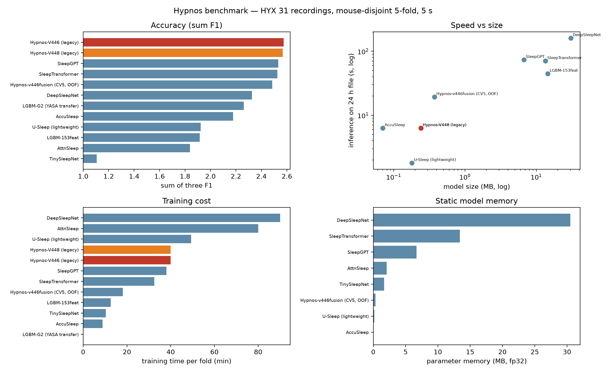
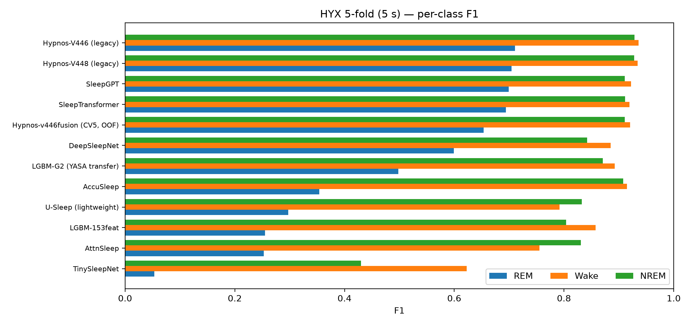

# Benchmark

## Protocol

- **Data**: 31 HYX recordings, 16 mouse groups; 3 classes (REM / Wake / NREM).
- **Split**: the same mouse-disjoint 5 folds for every model (table in
  [`METHODS.md`](METHODS.md)).
- **Epoch**: 5 s scoring. Native DB3 annotations are 10 s rows; the 5 s label is
  the repeated 10 s label. No epoch from a test mouse is ever trained on.
- **Training**: every model is trained from scratch on the training folds with
  the same labels. External models are faithful PyTorch ports written for this
  benchmark; see [`EXTERNAL_MODELS.md`](EXTERNAL_MODELS.md).
- **Scoring**: raw argmax at 5 s, **no HMM, no prior bias, no transition
  smoothing**. F1 is computed per recording, averaged over recordings, then over
  the five folds. `std R` is the population standard deviation of the five
  per-fold REM F1 means.
- **Selection**: one validation-based checkpoint per fold; test groups are
  scored once.

## Main table

| # | model | family | context | REM F1 | Wake F1 | NREM F1 | mean F1 | sum F1 | std REM | params |
|---|---|---|---|---|---|---|---|---|---|---|
| 1 | **Hypnos-V446 (legacy)** | project CNN | 9 (45 s) | **0.7108** | 0.9359 | 0.9284 | **0.8584** | **2.5752** | 0.0900 | — |
| 2 | **Hypnos-V448 (legacy)** | project CNN | 9 (45 s) | 0.7047 | 0.9344 | 0.9277 | 0.8556 | 2.5668 | 0.0920 | — |
| 3 | SleepGPT | time–frequency Transformer | 9×20 | 0.6994 | 0.9224 | 0.9110 | 0.8443 | 2.5328 | 0.0868 | 1,670,371 |
| 4 | SleepTransformer | two-level Transformer | 9×20 | 0.6940 | 0.9193 | 0.9116 | 0.8416 | 2.5249 | 0.0387 | 3,353,139 |
| 5 | **Hypnos-v446fusion (CV5, OOF)** | project CNN + band-ratio | 22 (110 s) | 0.6535 | 0.9203 | 0.9106 | 0.8281 | 2.4843 | 0.0536 | 88,607 |
| 6 | DeepSleepNet | CNN + BiLSTM | 20×5 s | 0.5993 | 0.8852 | 0.8420 | 0.7755 | 2.3264 | 0.0781 | 7,628,547 |
| 7 | LGBM-G2 (YASA transfer) | LightGBM | 5 s | 0.4982 | 0.8926 | 0.8706 | 0.7538 | 2.2615 | 0.0797 | — |
| 8 | AccuSleep | compact CNN | 9 | 0.3540 | 0.9149 | 0.9082 | 0.7257 | 2.1771 | 0.1734 | 14,835 |
| 9 | U-Sleep (lightweight) | U-Net | 20×5 s | 0.2974 | 0.7921 | 0.8326 | 0.6407 | 1.9221 | 0.0320 | 38,387 |
| 10 | LGBM-153feat | LightGBM | 5 s | 0.2548 | 0.8575 | 0.8039 | 0.6387 | 1.9162 | 0.0688 | — |
| 11 | AttnSleep | SE-CNN + TCE | 9 | 0.2529 | 0.7552 | 0.8310 | 0.6130 | 1.8391 | 0.0459 | 518,003 |
| 12 | TinySleepNet | CNN + GRU | 20×5 s | 0.0534 | 0.6224 | 0.4298 | 0.3685 | 1.1056 | 0.0688 | 421,123 |

## Reading the table

- **Our strongest row is not the 5-fold CV5 row.** It is the legacy V446/V448
  pair (`EPI=9`, 45 s context), which was trained under the same 5-fold protocol
  as the external models. The modern `v446fusion` CV5 row uses a **110 s**
  context and is scored raw at 5 s; it is included for completeness, not as the
  deployed configuration.
- The deployed model (`LAB-CV5-CORE-30EP`) is trained on all 31 recordings and
  then used on new recordings. It cannot be scored under the 5-fold protocol
  without leakage, so its numbers live in
  [`PRODUCTION.md`](PRODUCTION.md), separate from this table.
- **REM is the discriminating class.** Wake and NREM F1 are saturated near 0.9
  for almost every model; ranking by mean F1 is mostly ranking by REM F1.
  `sum F1` is shown because it is the metric used internally.
- **Context length matters.** Models with 45–110 s context (Hypnos, SleepGPT,
  SleepTransformer) outperform single-epoch or short-context models. The
  lightweight U-Sleep port is an exception: it is fast but weak on REM.
- **Variance is large.** Hypnos' cross-fold REM std is 0.09; SleepTransformer's
  is 0.04. A 0.01 difference between adjacent rows is not meaningful with 31
  recordings.

## Postprocessing on our model

The deployment decoder (fold to 10 s + 4.5 % REM prior + Viterbi λ=0.5) is
**not** used in the main table. On the 10 s folded labels, the same 5-fold OOF
predictions give REM 0.6828 / mean 0.8395 / sum 2.5186 with postprocessing,
and REM 0.7231 / mean 0.8908 / sum 2.6723 on core epochs. External G1 rows have
no equivalent postprocessing.

## Resource comparison

Parameters, weight size, static parameter memory, measured latency, GPU peak
memory, training time and 24 h inference time are in
[`results/resources.md`](../benchmark/results/resources.md).

Key point: the deployed Hypnos model is **88,607 parameters (0.39 MB ONNX)**,
runs a 5 s epoch in **1.12 ms on CPU** (ONNX Runtime, batch 1), and needs
**10 MB of GPU memory** at batch 1. It is roughly 38× smaller than
SleepTransformer and 86× smaller than DeepSleepNet.

## Limitations

- The HYX corpus is private; the numbers cannot be reproduced without data
  access. Code and feature format are public.
- Native labels are 10 s. 5 s metrics inherit the 10 s annotation granularity;
  "5 s performance" is not independent 5 s human scoring.
- Class imbalance is severe (REM ≈ 5–10 % of epochs). REM F1 is therefore noisy
  and sensitive to a handful of recordings.
- External models are re-implementations, not the authors' original code; port
  fidelity varies. They were trained with the same budget policy, not tuned
  per model.
- Single seed per model/fold. No confidence intervals are reported for external
  models.
- YASA (human pretrained) was evaluated on two recordings only and is excluded
  from the table; it predicts almost everything as NREM (domain gap).
